# Enterprise Intelligence Platform

SNOWFLAKE · DATA ENGINEERING · AI/ML · CLOUD SECURITY

A production-oriented enterprise data platform combining modern data warehousing, automated pipelines, machine learning, generative AI, data governance and cloud-native engineering.

## About

Enterprise Intelligence Platform is a production-oriented Snowflake-powered data platform for property management and real estate operations. It combines data ingestion, transformation, analytics, Snowpark ML, generative AI, governance, and operational monitoring into a single enterprise-ready solution for organisations that need secure, actionable intelligence across their portfolios.

The platform is designed to ingest structured and semi-structured operational data, enforce governance and security controls, model business performance through analytics and forecasting, and provide natural language insights for decision-making. It is built with modular architecture so it can extend beyond property operations into additional industries such as logistics, healthcare, retail, and financial services.

## Product Goals

- Ingest structured and semi-structured property and portfolio data.
- Organise data using a layered Warehouse model inspired by Snowflake architecture.
- Transform raw landings into curated business datasets.
- Run ML-driven predictions for arrears, occupancy, and maintenance demand.
- Deliver natural language enterprise analytics through an AI assistant.
- Apply enterprise security controls and governance policies.
- Support monitoring and operational visibility across data and platform services.

## Architecture

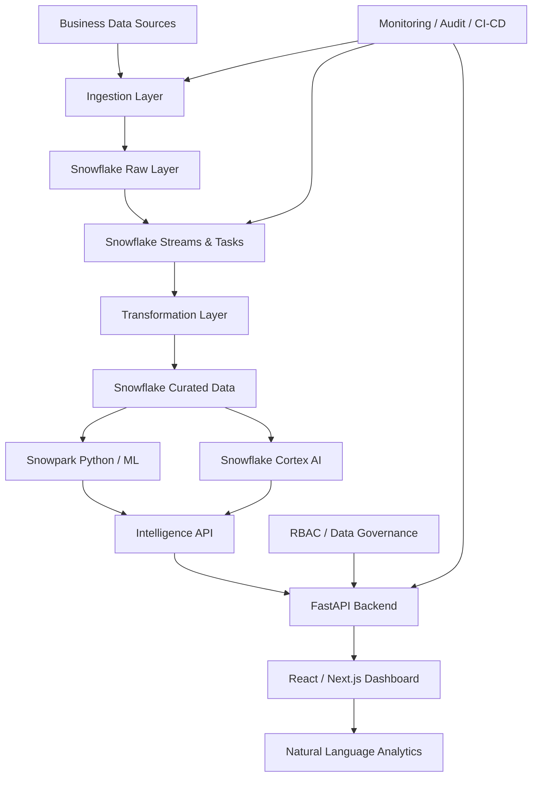

### High-level system architecture

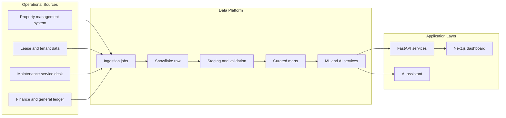

### Data ingestion and transformation lifecycle

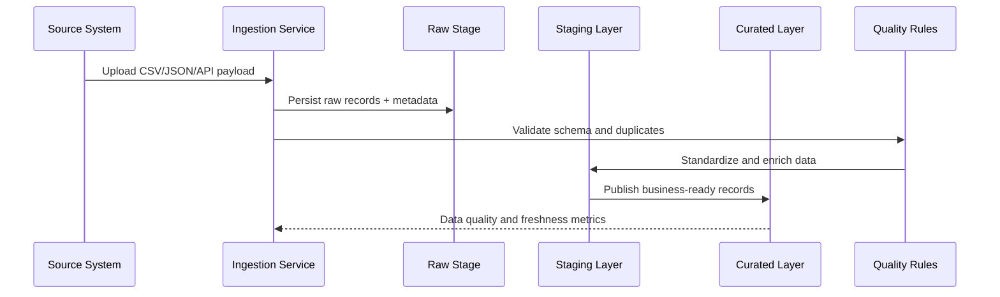

### AI and machine learning workflow

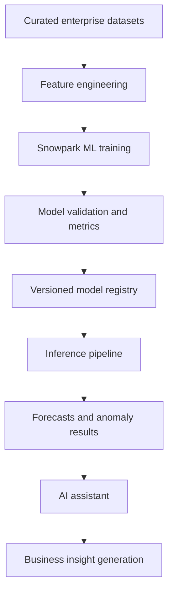

### Authentication and authorisation lifecycle

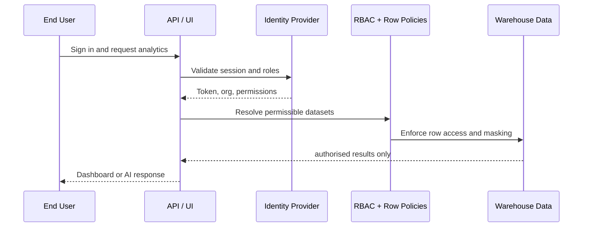

### Deployment architecture

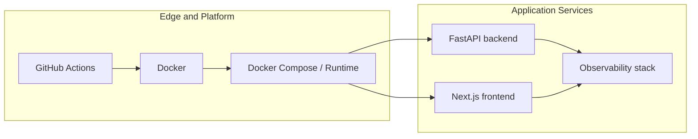

### CI/CD workflow

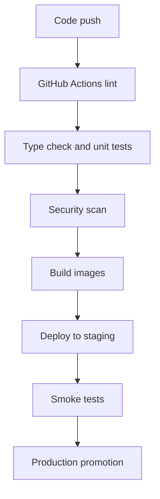

### Multi-tenant data isolation

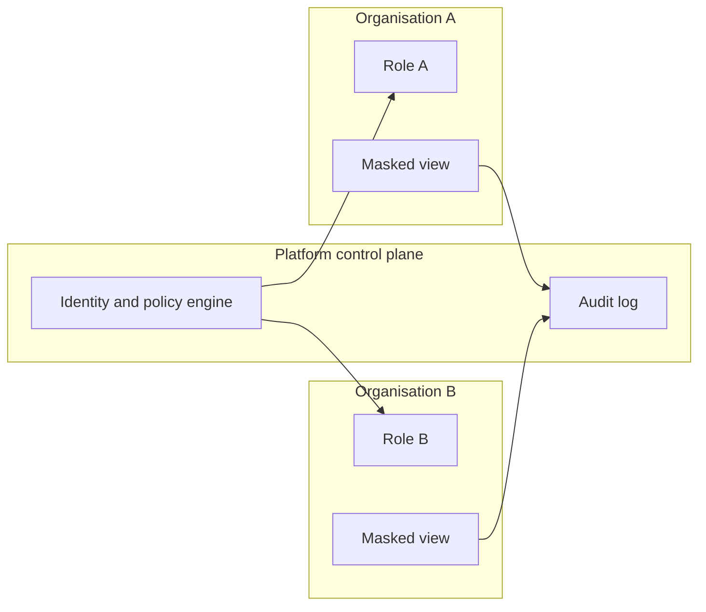

## Product UI Wireframes

The following wireframes reflect the product surface shipped in this repository.

### Wireframe A: Enterprise Dashboard

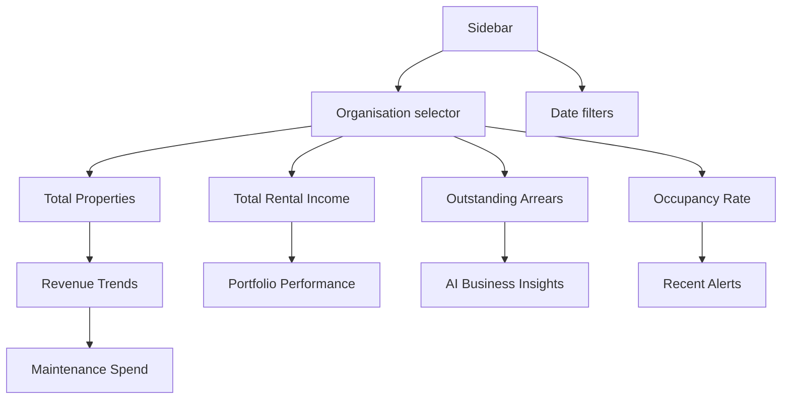

### Wireframe B: Data Engineering Console

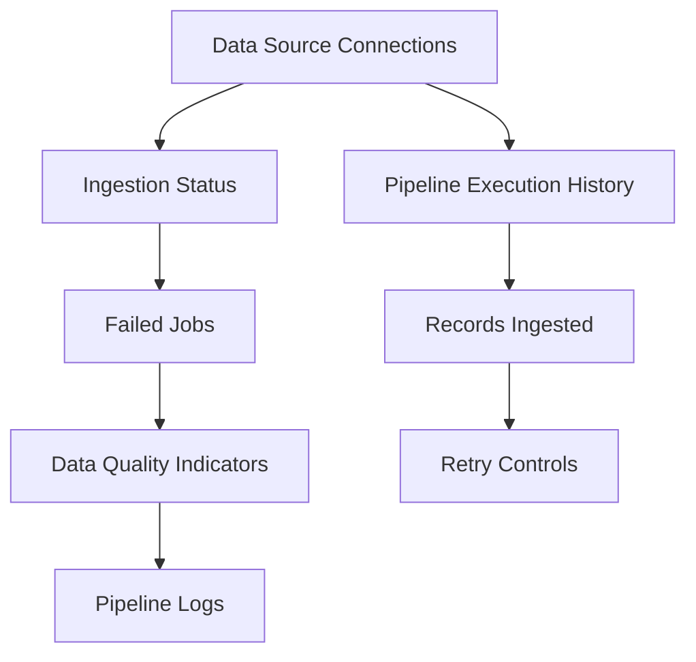

### Wireframe C: AI Intelligence Assistant

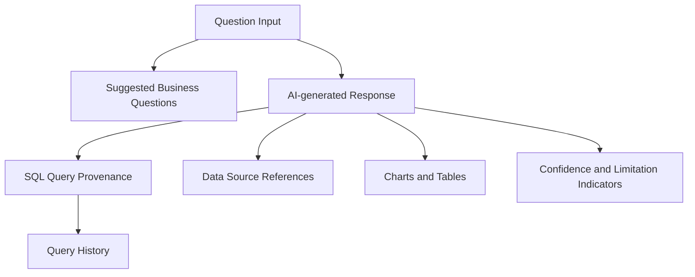

### Wireframe D: Security and Governance Console

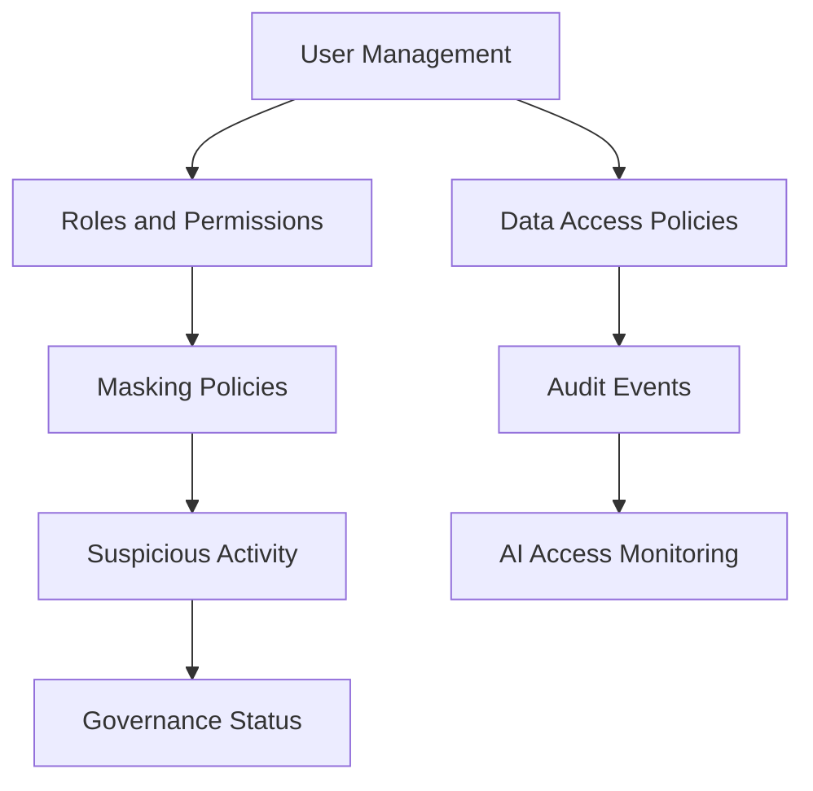

### Wireframe E: ML and Forecasting Dashboard

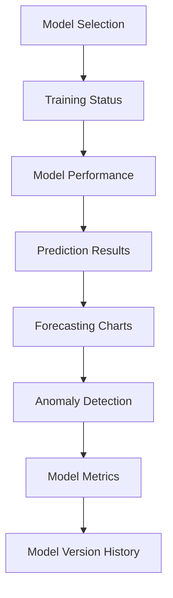

### Wireframe F: Infrastructure and Monitoring

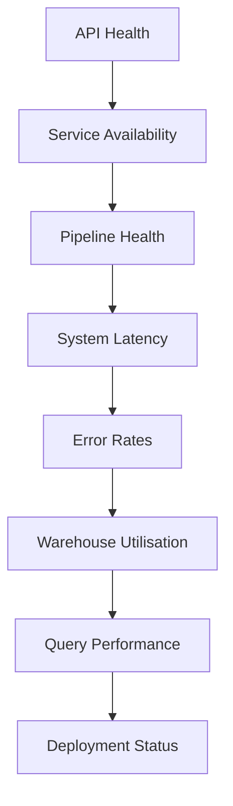

## Repository Structure

- `backend/` — Python FastAPI application, ingestion services, and API layer.
- `frontend/` — Next.js dashboard and enterprise UI.
- `docs/wireframes/` — diagram source files for the product interface and operational design.
- `terraform/` — infrastructure definitions.
- `.github/workflows/` — automated CI/CD pipeline definition.
- `docker-compose.yml` — full local platform stack.

## Local Startup

```bash
docker compose up --build
```

Then open:

- Frontend: http://localhost:3000
- Backend API: http://localhost:8000/docs

## Core Features Delivered

- Property portfolio analytics dashboard.
- Rental and arrears overview metrics.
- Maintenance and occupancy insights.
- AI assistant grounded in demo operational data.
- Ingestion and pipeline status endpoints.
- Security and governance summary model.
- Observability status for health checks and operations.
- Dockerised local deployment with CI pipeline metadata.

## Security and Compliance Notes

This repository demonstrates enterprise-grade controls and policies in a prototype architecture. It does not replace formal production review, tenant isolation planning, or cloud security hardening required for a regulated environment.

## License

This project is provided for demonstration, architecture, and engineering exploration. Users should adapt it to their own contractual and regulatory requirements before production deployment.
