# Enterprise Intelligence Platform

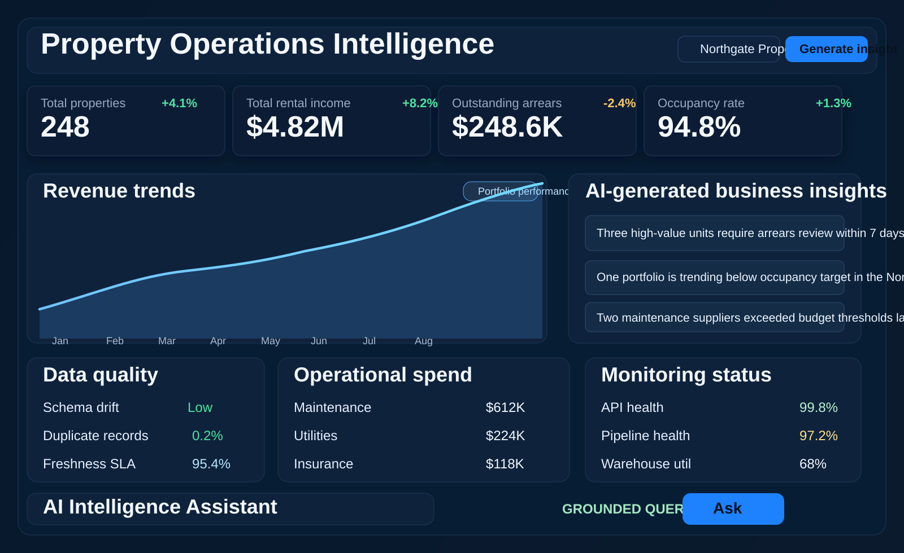

SNOWFLAKE · DATA ENGINEERING · AI/ML · CLOUD SECURITY

A production-oriented enterprise data platform combining modern data warehousing, automated pipelines, machine learning, generative AI, data governance and cloud-native engineering.

## About

Enterprise Intelligence Platform is a production-oriented Snowflake-powered data platform for property management and real estate operations. It combines data ingestion, transformation, portfolio and sales analytics, Snowpark ML, a grounded generative AI assistant, governance, integrations, and operational monitoring into a single enterprise-ready solution for organisations that need secure, actionable intelligence across their portfolios.

The platform is designed to ingest structured and semi-structured operational data, connect CRM and sales systems, enforce governance and security controls, model business performance through analytics and forecasting, and provide natural language insights for decision-making. It is built with modular architecture so it can extend beyond property operations into additional industries such as logistics, healthcare, retail, and financial services.

## Product Goals

- Ingest structured and semi-structured property, portfolio, and sales pipeline data.
- Organise data using a layered Warehouse model inspired by Snowflake architecture.
- Transform raw landings into curated business datasets.
- Run ML-driven predictions for arrears, occupancy, maintenance demand, and sales pipeline coverage.
- Deliver natural language enterprise analytics through the grounded AI Assistant.
- Track sales opportunities, targets, channels, and closed-won performance.
- Connect external systems through a managed integrations surface.
- Apply enterprise security controls, workspace settings, and governance policies.
- Support monitoring and operational visibility across data and platform services.

## Architecture

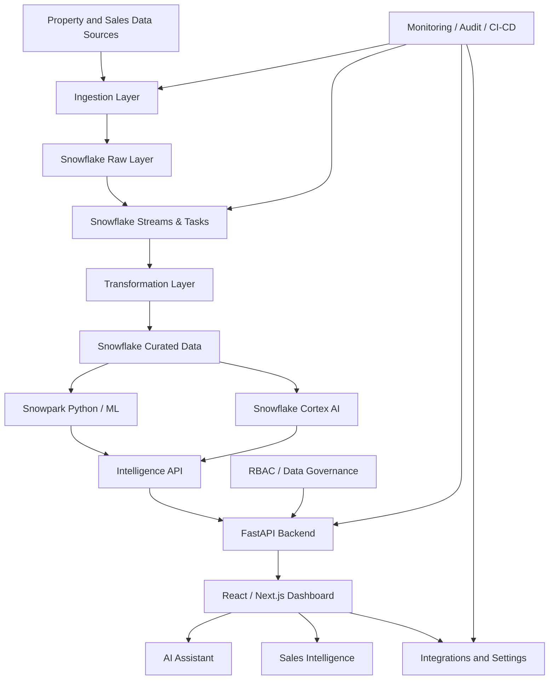

### High-level system architecture

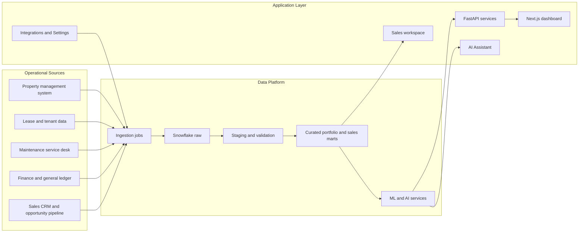

### Data ingestion and transformation lifecycle

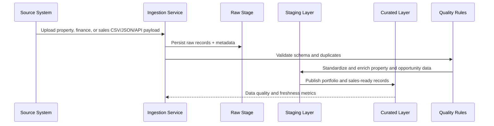

### AI and machine learning workflow

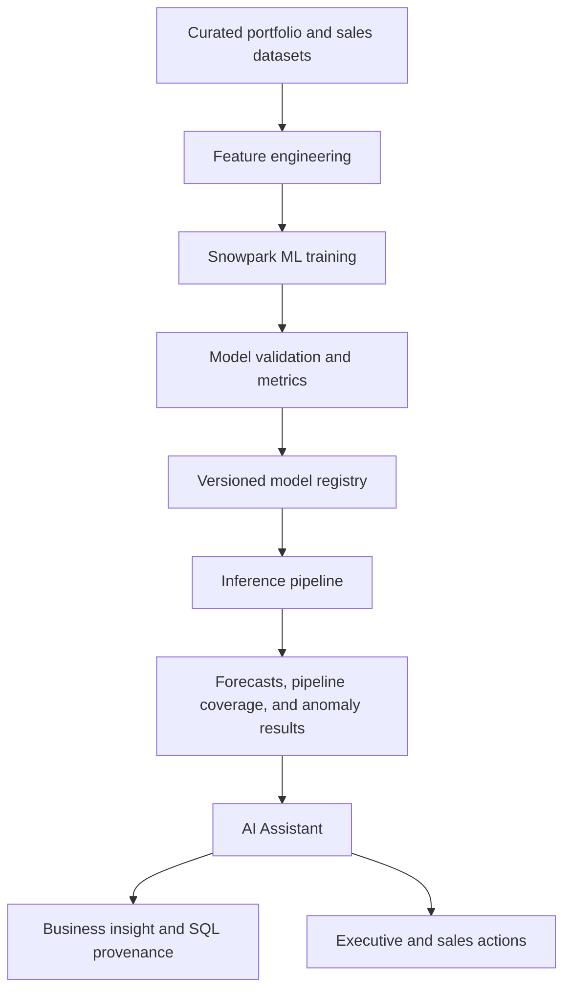

### Authentication and authorisation lifecycle

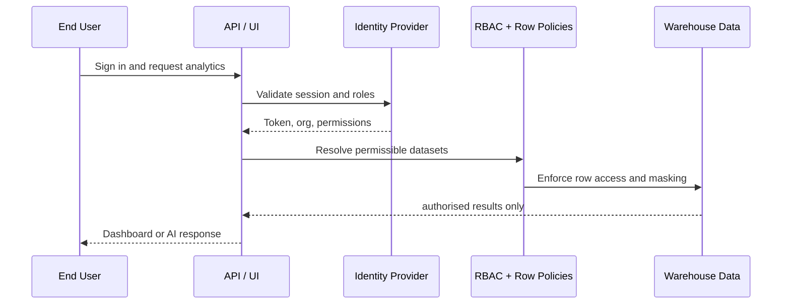

### Deployment architecture

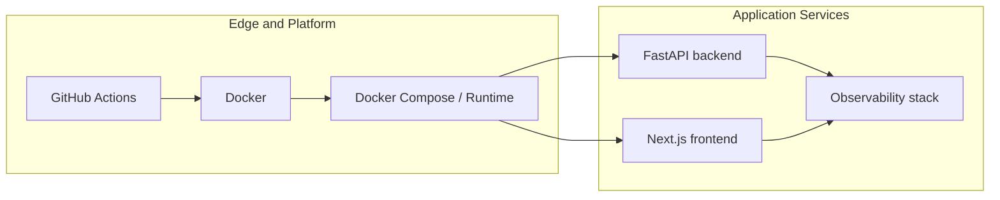

### CI/CD workflow

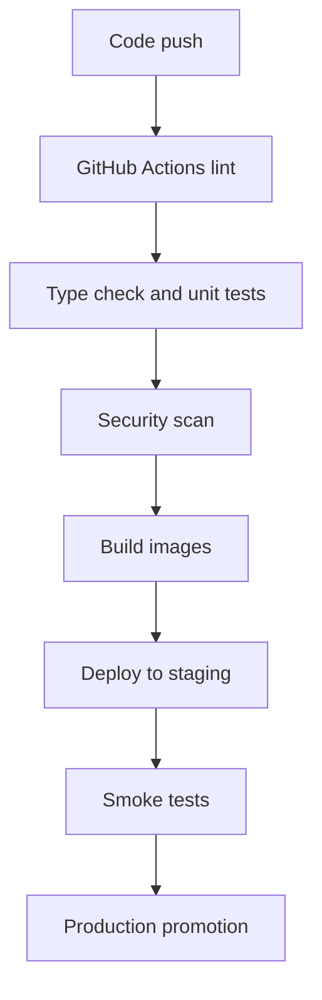

### Multi-tenant data isolation

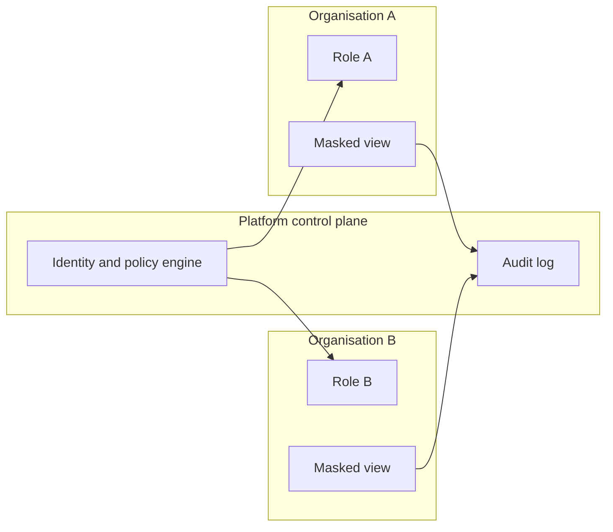

## Product UI Wireframes

The following wireframes reflect the product surface shipped in this repository.

### Wireframe A: Enterprise Dashboard

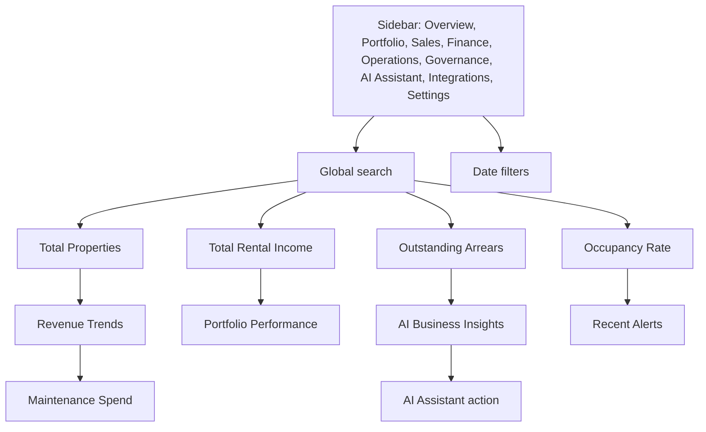

### Wireframe B: Data Engineering Console

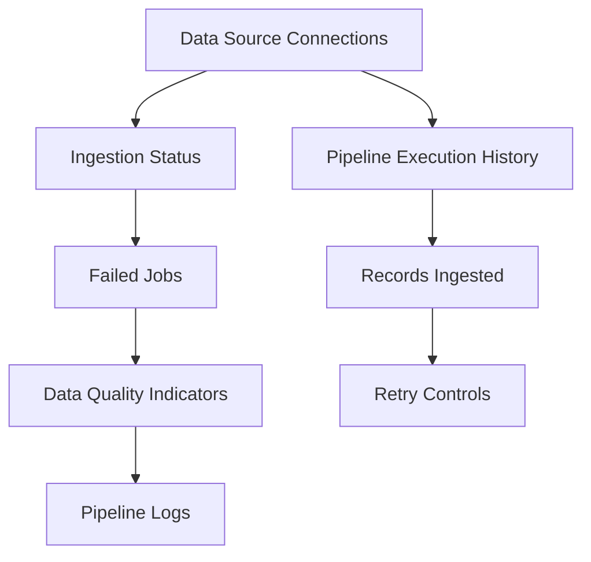

### Wireframe C: AI Assistant

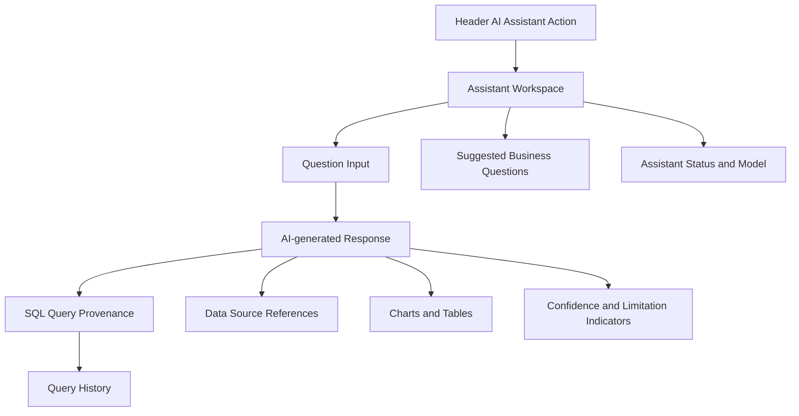

### Wireframe D: Security and Governance Console

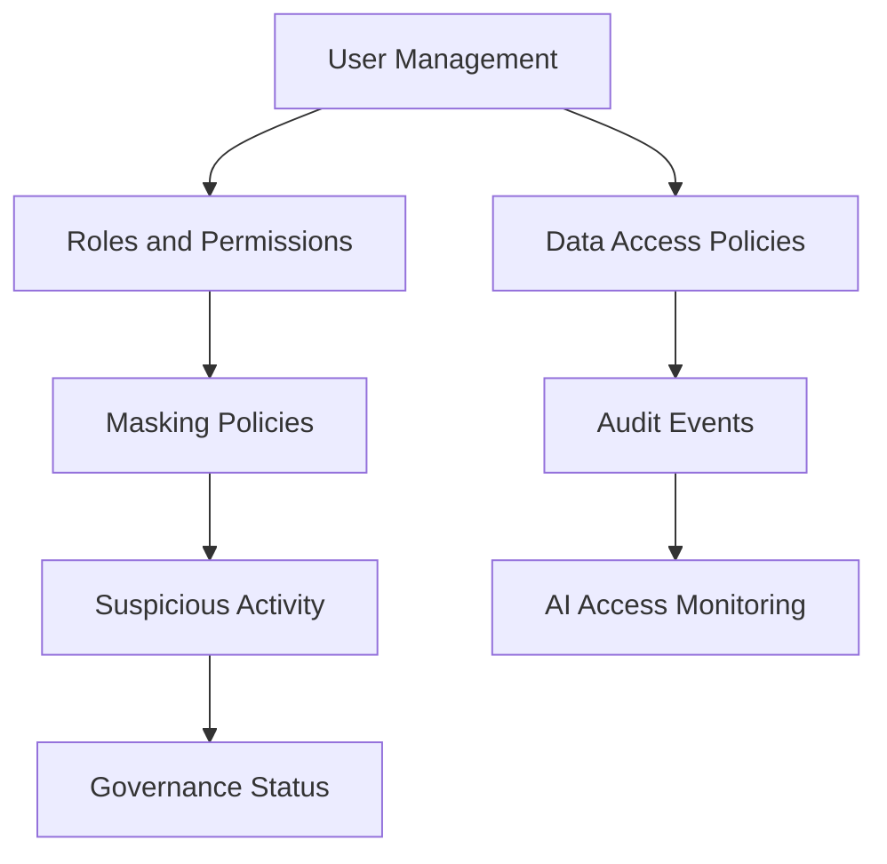

### Wireframe E: ML and Forecasting Dashboard

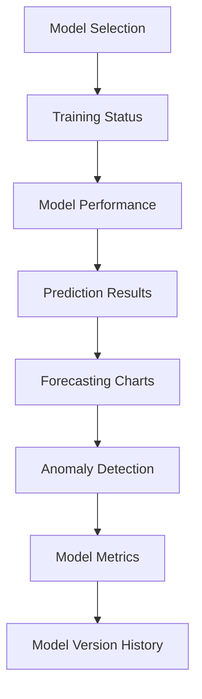

### Wireframe F: Infrastructure and Monitoring

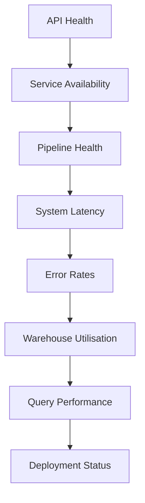

### Wireframe G: Sales Workspace

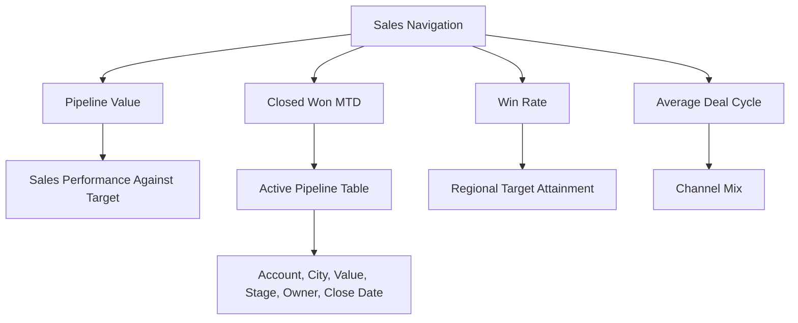

### Wireframe H: Integrations

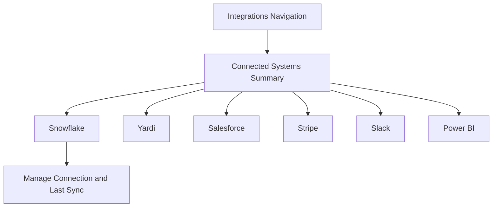

### Wireframe I: Settings

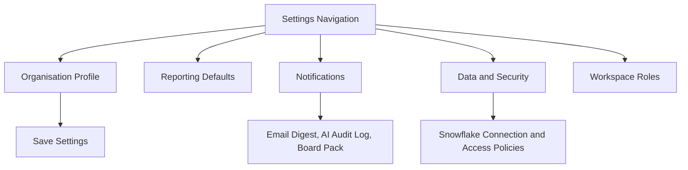

## Repository Structure

- `backend/` — Python FastAPI application, ingestion services, sales and AI Assistant endpoints, and API layer.
- `frontend/` — Next.js dashboard covering portfolio, sales, finance, operations, governance, AI Assistant, integrations and settings.
- `dbt/` — staging and mart models for portfolio and sales pipeline analytics.
- `sql/snowflake/` — warehouse, property, sales, security and governance DDL.
- `docs/wireframes/` — diagram source files for the product interface and operational design.
- `terraform/` — infrastructure definitions including landing, sales, curated and audit storage.
- `.github/workflows/` — automated CI/CD pipeline definition.
- `docker-compose.yml` — full local platform stack.

## API Surface

- `GET /api/v1/dashboard/overview` — executive portfolio metrics and alerts.
- `GET /api/v1/sales` — sales pipeline, targets, channels and opportunity detail.
- `GET /api/v1/analytics`, `/api/v1/finance`, `/api/v1/maintenance` — operational analytics.
- `GET /api/v1/ai/assistant` — assistant status, capabilities and suggested questions.
- `POST /api/v1/ai/query` — grounded natural language analytics with SQL provenance.
- `GET /api/v1/ingestion`, `/api/v1/pipelines`, `/api/v1/monitoring` — data platform operations.
- `GET /api/v1/security`, `/api/v1/governance`, `/api/v1/audit` — governance and audit views.

## Local Startup

```bash
docker compose up --build
```

Then open:

- Frontend: http://localhost:3000
- Backend API: http://localhost:8000/docs

## Core Features Delivered

- Property portfolio analytics dashboard with city-level performance, composition, watchlist and lease expiry views.
- Sales workspace with pipeline value, closed-won performance, regional target attainment, channel mix and active opportunity table.
- Finance workspace with revenue trends, arrears ageing, cost breakdown, forecast variance and recent transactions.
- Operations workspace with work-order queue, maintenance spend, SLA performance, vendor scorecards and scheduled maintenance.
- Governance workspace with roles, compliance posture, audit events and data access policies.
- Grounded AI Assistant with suggested questions, SQL provenance, source references, confidence and limitations.
- Global search across properties, sales opportunities and navigation sections.
- Integrations workspace for Snowflake, Yardi, Salesforce, Stripe, Slack and Power BI.
- Settings workspace for organisation profile, reporting defaults, notifications, data security and workspace roles.
- Ingestion and pipeline status endpoints.
- Security and governance summary model.
- Observability status for health checks and operations.
- Dockerised local deployment with CI pipeline metadata.

## Security and Compliance Notes

This repository demonstrates enterprise-grade controls and policies in a prototype architecture. It does not replace formal production review, tenant isolation planning, or cloud security hardening required for a regulated environment.

## License

This project is provided for demonstration, architecture, and engineering exploration. Users should adapt it to their own contractual and regulatory requirements before production deployment.
