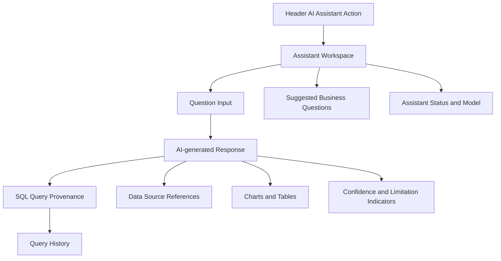

# Wireframe C: AI Assistant

## API endpoints

- `GET /api/v1/ai/assistant`
- `POST /api/v1/ai/query`

## Governance

AI interactions are logged in `curated.ai_interaction_log` with user, organisation, question text, generated SQL, confidence score and execution status. The assistant is grounded in curated portfolio and sales datasets and reports confidence plus limitations with every answer.
