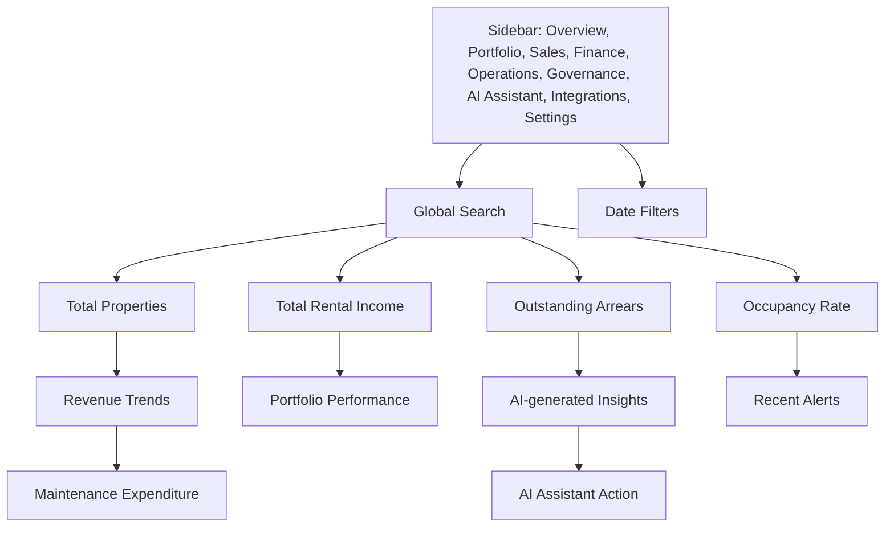

# Wireframe A: Enterprise Dashboard

## Header actions

- Global search across properties, sales opportunities and navigation sections.
- AI Assistant action opens the grounded assistant workspace.

## Sidebar sections

- Overview
- Portfolio
- Sales
- Finance
- Operations
- Governance
- AI Assistant
- Integrations
- Settings
