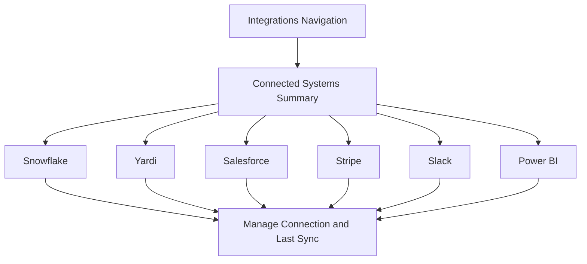

# Wireframe H: Integrations

## Notes

Each integration card shows category, connection status, last sync time, data scope and a connect or manage action. Salesforce supplies the sales opportunity pipeline that feeds `curated.sales_pipeline_fact`.
