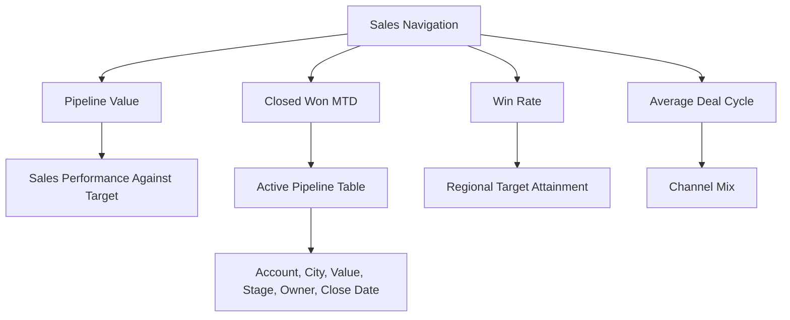

# Wireframe G: Sales Workspace

## Data sources

- `curated.sales_account_dim`
- `curated.sales_rep_dim`
- `curated.sales_pipeline_fact`
- `mart.mart_sales_pipeline_kpis`

## API endpoints

- `GET /api/v1/sales`

## Notes

The sales workspace is part of the primary dashboard navigation and is accessible from the global sidebar. It consumes the same governed warehouse layer as portfolio, finance and operations views.
