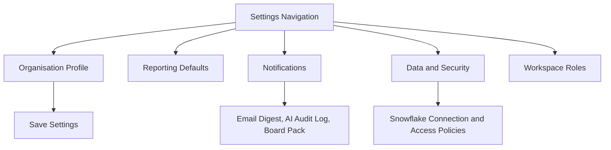

# Wireframe I: Settings

## Notes

Settings control organisation identity, reporting period, timezone, default currency, notification preferences and workspace access. The AI audit logging preference governs whether AI Assistant questions and generated SQL are retained for governance review.
